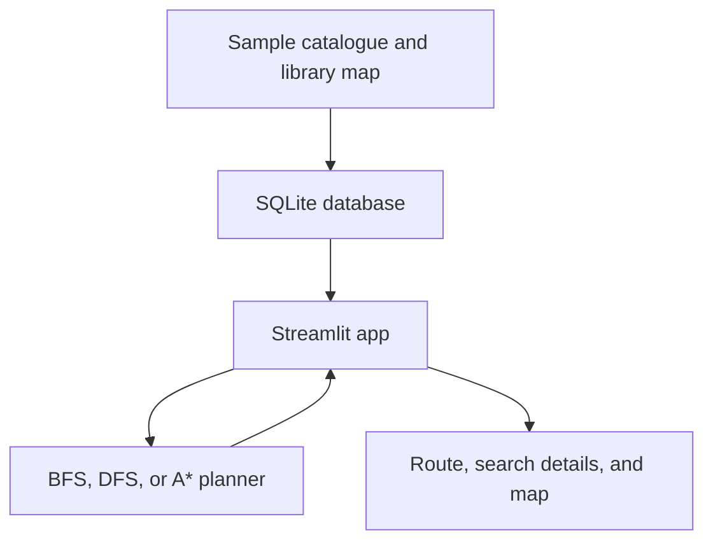

# Intelligent Library Search and Book Collection Agent

A local Streamlit app that helps a reader find books and plan a route through a sample library. The library map is modeled as a weighted graph: Breadth-First Search (BFS) and Depth-First Search (DFS) find a single book, while an A* planner creates a route for collecting several books.

The planner can account for closed sections, restricted shelves, unavailable books, crowded aisles, walking speed, pickup time, a time limit, and book priorities. The app displays the route, search frontier and explored locations, and a map of the library.

## Features

- Find one book with BFS or DFS and inspect the open and closed lists.
- Plan a multi-book route with A*.
- Optimise for walking distance or a crowd-adjusted walking cost.
- Apply closure, shelf restriction, book availability, and aisle crowding conditions.
- Set walking speed, pickup time, book priority, and a collection time limit.
- See books collected or skipped, with the reason for each skipped book.
- View the library map, route cost, estimated time, catalogue, and recent routes.
- Store the catalogue and route history in SQLite.

## How It Works



The graph's nodes are library locations and its edges are walkways. BFS and DFS explore locations to find one shelf. A* searches states that contain the current location and the set of collected books. For multi-book planning, the app considers available books and selects the highest-priority feasible subset under the time limit, then finds a low-cost collection order for that subset.

The planner performs exact subset optimisation for up to eight candidate books. When more are selected, it keeps the highest-priority eight and reports the rest as skipped.

## Requirements

- Python 3.10 or later
- A modern web browser
- Dependencies listed in [`requirements.txt`](requirements.txt)

SQLite is included with Python. The app runs locally and needs no network connection after dependencies are installed.

## Setup

Clone or download the repository, then open a terminal in its root folder.

### 1. Create a virtual environment

Windows PowerShell:

```powershell
py -m venv .venv
.venv\Scripts\Activate.ps1
```

macOS or Linux:

```bash
python3 -m venv .venv
source .venv/bin/activate
```

### 2. Install dependencies

```bash
python -m pip install -r requirements.txt
```

### 3. Run the app

```bash
python -m streamlit run app.py
```

Open the local URL printed in the terminal, usually `http://localhost:8501`.

### 4. Run the checks

```bash
python test_agent.py
```

The script checks book searches, route planning, time limits, crowd costs, graph conditions, and database operations. It uses Python's built-in `assert` statements and does not need a separate test framework.

## Using the App

1. Search for and select the books you want to collect.
2. Select A* to plan a collection route, or choose BFS or DFS and select one target book.
3. Choose a starting location and set any library conditions or route constraints in the sidebar.
4. Select **Calculate route**.
5. Review the route, cost, estimated time, search logs, map, and skipped-book explanations.

The catalogue and availability can be viewed in the app. Availability changes and calculated routes are stored in the local database.

## Project Structure

```text
.
├── app.py               # Streamlit user interface and library map
├── agent.py             # Graph, BFS, DFS, and A* route-planning logic
├── database.py          # SQLite schema, sample data, and database operations
├── sample_books.csv     # Initial sample book catalogue
├── test_agent.py        # Automated checks for agent and database behavior
├── requirements.txt     # Python dependencies
├── .gitignore           # Local files excluded from Git
└── README.md
```

On first launch, `database.py` creates `library.db` in the project folder and seeds it with the sample map and catalogue. The database is ignored by Git. To restore the original sample data, stop the app, delete `library.db`, and launch it again.

## Limitations

- The app uses a fictional library layout and a small sample catalogue.
- Exact subset optimisation is limited to eight candidate books.
- Crowd levels, walking speed, and pickup time are user-entered estimates.
- The app does not connect to a live library catalogue or sensor data.
- The route planner does not add a return trip to the entrance.

## Future Improvements

- Load real floor plans and support multiple floors.
- Connect to a library management system for live availability.
- Add checkout-desk and return-to-entrance routing.
- Estimate crowding from live data and improve planning for larger selections.
- Add a mobile layout with turn-by-turn directions.

## Technology

Python · Streamlit · NetworkX · SQLite · Matplotlib

## References

- Stuart Russell and Peter Norvig, *Artificial Intelligence: A Modern Approach*, 4th edition, Pearson, 2021.
- P. E. Hart, N. J. Nilsson, and B. Raphael, “A Formal Basis for the Heuristic Determination of Minimum Cost Paths,” *IEEE Transactions on Systems Science and Cybernetics*, 1968.
- [NetworkX documentation](https://networkx.org/documentation/stable/)
- [Streamlit documentation](https://docs.streamlit.io/)
- [Python sqlite3 documentation](https://docs.python.org/3/library/sqlite3.html)
- [Matplotlib documentation](https://matplotlib.org/stable/)
